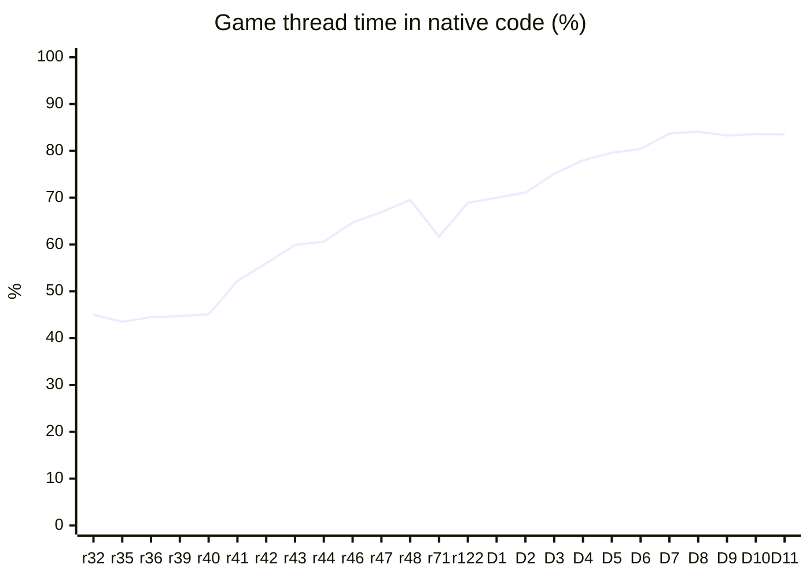

# SotC Mac (Celosia)

Port nativo de **Shadow of the Colossus** (PS2, versão americana, SCUS-97472)
para macOS (Apple Silicon) e **PS Vita**. O código MIPS do jogo é recompilado
estaticamente para C++ com [PS2Recomp](https://github.com/ran-j/PS2Recomp).

Nenhum emulador roda o código de CPU do jogo. O código do EE (o ELF de boot e
os três módulos XFF) é traduzido para C++ antes da execução e compilado como
código nativo. A imagem sai de um renderizador próprio (Metal no Mac, OpenGL
ES no Vita), que lê os modelos direto da memória do jogo. O resto do hardware
que o jogo usa (DMA, IOP, SPU2) foi reescrito como código do host.

> **Nenhum dado do jogo vem no repositório.** Você precisa da sua própria cópia.

> **Fork.** Este repositório é um fork de
> [HenryKun55/celosia](https://github.com/HenryKun55/celosia), modificado por
> [moraiskaua](https://github.com/moraiskaua) a partir de 26/11/2026: README e
> documentação em português, correções de build no Mac e texture packs. O
> histórico do git mostra cada mudança. A licença continua GPL-3.0.

Página de progresso do projeto original:
[henrykun55.github.io/celosia](https://henrykun55.github.io/celosia/).
Situação atual em detalhe: [docs/STATUS.md](docs/STATUS.md).

## Situação


| Área | Estado |
| --- | --- |
| Boot, logos, cinemática de abertura | ✅ |
| Renderizador nativo (modelos, personagens, 2D, névoa, bloom, sombras, reflexos, água) | ✅ todos os 49 recursos acompanhados são nativos |
| Áudio (SPU2: vozes, ADSR, reverb, streaming) | ✅ |
| Tela de título, menus | ✅ |
| Memory card (libmc2, `memcards/Mcd001.ps2` compatível com PCSX2) | ✅ |
| Novo jogo, introdução, cavalgar Agro, gameplay | ✅ |
| Desempenho no Mac (M4 Pro) | 60 fps, desenhado em 1536×1344 |
| PS Vita | ✅ compila e roda (18 a 25 fps na abertura no Vita3K); fidelidade e velocidade em andamento |
| Descompilação | em andamento ([docs/decomp.md](docs/decomp.md)) |

## Requisitos

- macOS em Apple Silicon, com as Command Line Tools do Xcode
- `brew install cmake ninja pkg-config ffmpeg python` (Python 3.9 ou mais novo)
- Imagem do disco de **Shadow of the Colossus (USA)** (`SCUS_974.72`), em
  `.iso` ou num `.zip` com a `.iso` dentro
- Uns 10 GB livres e internet no primeiro build (o CMake baixa raylib, imgui
  e sse2neon)

## Começo rápido

```sh
git clone https://github.com/moraiskaua/sotc-mac.git
cd sotc-mac
./celosia setup --iso "/caminho/para/Shadow of the Colossus (USA).iso"
./celosia run
```

O `setup` demora na primeira vez: compila o runtime e cerca de 16 mil funções
recompiladas. Durante a captura de cada módulo ele abre a janela do jogo
rapidamente algumas vezes (veja [Como funciona](#como-funciona)). Isso é
esperado.

## Menus e atalhos

| Tecla | O que faz |
| --- | --- |
| **F1** (Select duas vezes no Vita) | menu do jogador: vídeo, som, idioma (português ou inglês), qualidade, gráficos e a aba **Debug** |
| **F10** (Mac) | painel do renderizador nativo: resolução, bloom, névoa e cada efeito, ao vivo |
| **F9** (Mac) | alterna entre a imagem nativa e a do GS emulado no mesmo momento |
| **F8** (Mac) | salva o mesmo momento duas vezes em `shots/` (emulado e nativo) e a lista de draws |
| **F12** | debugger de desenvolvimento (CPU, threads, DMA, memória) |

No menu F1: L1 / R1 trocam de aba, cima / baixo escolhem o item, X ou
esquerda / direita mudam o valor, Triângulo mostra ajuda, O ou Select fecha.
Enquanto o menu está aberto o jogo não recebe o controle.

Pontos úteis do menu:

- **Qualidade**: os cortes de desempenho, todos desligados por padrão e salvos
  em `settings.cfg`: menos partículas (`SOTC_SAC_PARTICLES`), detalhe de
  modelo reduzido (`SOTC_SAC_LOD`), menos checagens da câmera
  (`SOTC_SAC_CAMCOLL`), personagens distantes a meia taxa
  (`SOTC_SAC_FARCHARA`), efeitos a meia taxa (`SOTC_SAC_FX`), distância de
  visão menor (`SOTC_SAC_DRAWDIST`) e desempenho máximo (`SOTC_SAC_MAX=1`,
  liga os quatro últimos).
- **Gráficos → Taxa de quadros**: **Auto** (padrão) ou **20 estável**
  (`SOTC_CAP20`). No Vita as cenas ficam sempre limitadas a 30 fps.
- **Gráficos → Pacote de texturas** e **Debug → Extrair texturas**: troca de texturas
  por PNGs seus ([docs/texture_packs.md](docs/texture_packs.md)).
- **Gráficos → Tela larga** (`SOTC_WIDESCREEN=1`): o modo 16:9 do próprio
  jogo, aberto até preencher a janela, com HUD nos cantos e menus na
  proporção certa. **F11**: tela cheia
  ([docs/widescreen.md](docs/widescreen.md)).
- **Debug**: muda as chaves de desenvolvimento ao vivo, sem editar `env.txt`
  nem reiniciar. Também tem **Marcar este momento** (escreve `[mark]` no log),
  **Painel de desempenho** (`SOTC_PERF_OVERLAY=1`) e **Gravar cena**, que
  grava tudo o que o renderizador desenha em `logs/rec/` (no Vita,
  `ux0:data/celosia/rec/`); `tools/rec.py` lê e redesenha essas gravações.

A tabela completa dos ajustes do F10 está em
[docs/STATUS.md](docs/STATUS.md#settings).

### Controles

Gamepad funciona direto, inclusive o 8BitDo Ultimate 2 por Bluetooth. Um
controle que o jogo não reconhece aparece no `logs/play.log` como
`[pad] controller ... has no gamepad mapping` com o GUID dele: coloque a linha
desse GUID do [SDL_GameControllerDB](https://github.com/mdqinc/SDL_GameControllerDB)
num `gamecontrollerdb.txt` na pasta do jogo (ou aponte `PS2X_GAMEPAD_DB` pra
ele). No teclado:

| Teclas | PS2 |
| --- | --- |
| W A S D | analógico esquerdo |
| setas | direcional |
| H / J | ✕ / ○ |
| Y / U | □ / △ |
| I / O | L1 / L2 |
| K / L | R1 / R2 |
| Z / X | Start / Select |

## Como funciona

O jogo tem um ELF de boot pequeno e carrega o resto do código em tempo de
execução: `KERNEL.XFF`, `MANAGER.XFF` e `GAMECORE.XFF`. São módulos
relocáveis que o próprio jogo liga na memória. Um recompilador estático
precisa de todo o código antes, então o `setup` monta tudo em etapas:

1. **ELF de boot.** As fronteiras das funções vêm de `tools/funcmap_elf.py`,
   os nomes vêm dos imports do `KERNEL.XFF`. O ELF é recompilado com
   `game/scus.toml`.
2. **Captura de módulo.** O jogo roda até pular para código que ainda não foi
   recompilado, que é a entrada do próximo módulo. A RAM do guest é salva
   nesse momento (`PS2X_DUMP_RAM_ON_MISSING`) e o módulo carregado é
   recortado do dump (`tools/modimage.py`).
3. **Link.** `tools/build_elf.py` junta o ELF de boot e os módulos capturados
   num único `SOTC.elf`, com o mapa de funções e as instruções que o linker do
   jogo reescreve. `tools/gen_config.py` gera a configuração do recompilador.
4. Os passos 2 e 3 se repetem para KERNEL, MANAGER e GAMECORE. Nessas etapas
   parciais o runner é compilado sem `game/overrides`, que só compila com o
   jogo inteiro recompilado.
5. **VU1.** Uma execução roteirizada grava cada microcódigo de VU1 que o jogo
   envia, e cada um vira C++ (`./celosia vu1`).

Tudo o que é gerado (código recompilado, capturas, build) fica em `build/` e
não vai para o git. A visão das peças e de como elas conversam está em
[docs/arquitetura.md](docs/arquitetura.md).

## PS Vita

```sh
export VITASDK=~/vitasdk
./celosia vita          # depois do ./celosia setup: build/vita/ps2xRuntime/ps2EntryRunner.vpk
```

A primeira vez também compila o vitaGL numa revisão fixa, com os patches do
port. Instale o `.vpk` (VitaShell, ou File › Install no Vita3K) e coloque o
disco extraído em `ux0:data/celosia/disc/`. Saves vão para
`ux0:data/celosia/memcards/`, logs para `ux0:data/celosia/log.txt` e
`err.txt`. O Vita não tem variáveis de ambiente: `ux0:data/celosia/env.txt`
recebe linhas `NOME=valor`.

## Descompilação

O código recompilado funciona, mas não é legível. As funções que importam
estão sendo reescritas à mão em C++ e comparadas com as recompiladas, byte a
byte, sobre o mesmo estado da máquina (`SOTC_DIFFTEST`). É uma descompilação
funcional, não de binário idêntico. As mais usadas vêm primeiro. O método
(profiler do guest, scripts do Ghidra, difftest) está em
[docs/decomp.md](docs/decomp.md). Cada função nativa está listada em
[docs/decomp_status.json](docs/decomp_status.json) e o histórico em
[docs/decomp_history.json](docs/decomp_history.json).

O bloco abaixo é gerado por `tools/decomp_tree.py --readme` e fica em inglês.

<!-- decomp:start (tools/decomp_tree.py --readme writes this block) -->

**Game thread time on the Vita** (D11, Vita3K profile):

| | share | |
|---|---:|---|
| Native code | 83.5% | `█████████████████░░░` |
| Recompiled MIPS | 4.0% | `█░░░░░░░░░░░░░░░░░░░` |
| Runtime (DMA walk, memory, scheduler, glue) | 12.5% | `██░░░░░░░░░░░░░░░░░░` |

<details open>
<summary><b>By area of the game</b>: what is native and what still runs as recompiled MIPS</summary>

| Area | Code native | | Functions | Game thread time: native / MIPS |
|---|---:|---|---:|---|
| Other game code (names not identified yet) | 59.2% | `███████░░░░░` | 1671 / 2905 | 22.5% / 1.9% |
| Display and models | 61.6% | `███████░░░░░` | 507 / 977 | 19.1% / 0.6% |
| Characters and motion | 67.0% | `████████░░░░` | 651 / 1207 | 13.9% / 0.5% |
| Collision and physics | 52.3% | `██████░░░░░░` | 174 / 317 | 10.9% / 0.1% |
| Particles and effects | 87.9% | `███████████░` | 91 / 114 | 4.9% / 0.0% |
| System and memory | 64.9% | `████████░░░░` | 138 / 230 | 4.4% / 0.0% |
| Boot ELF, SDK and libc | 53.7% | `██████░░░░░░` | 1305 / 2135 | 2.2% / 0.7% |
| Math | 100.0% | `████████████` | 122 / 122 | 2.6% / 0.0% |
| Script and events | 42.4% | `█████░░░░░░░` | 232 / 633 | 2.0% / 0.1% |
| Camera | 76.0% | `█████████░░░` | 199 / 282 | 0.8% / 0.1% |
| Sound | 72.2% | `█████████░░░` | 71 / 102 | 0.1% / 0.0% |
| Runtime (DMA walk, memory, scheduler) | | | | 12.5% (runtime) |

</details>

<details>
<summary><b>History</b></summary>

| Measured | Commit | Code native | Calls native | Game thread time native |
|---|---|---:|---:|---:|
| 2026-10-23 | ed10257 | 4.24% | 34.1% |  |
| 2026-10-23 | fce6b0c | 4.31% | 39.6% |  |
| 2026-10-23 | e51649c | 4.51% | 40.3% |  |
| 2026-10-24 | 33afe16 | 4.65% | 40.6% |  |
| 2026-10-25 | d44f871 | 4.69% | 40.9% |  |
| 2026-10-25 | 23595fb | 4.73% | 41.6% |  |
| 2026-10-26 | a7829ef | 5.25% | 51.4% |  |
| 2026-10-27 | bb0bfd8 | 5.25% | 47.5% |  |
| 2026-10-27 | d2d8bb1 | 5.30% | 47.7% |  |
| 2026-10-27 | 3dfcd50 | 5.40% | 47.8% |  |
| 2026-10-29 | a61cb0d | 5.41% | 47.9% |  |
| 2026-10-29 | r32 | 5.41% | 47.9% | 45.0% |
| 2026-10-30 | r35 | 5.41% | 47.9% | 43.5% |
| 2026-10-30 | r36 | 5.41% | 47.9% | 44.5% |
| 2026-10-30 | r39 | 5.59% | 49.0% | 44.7% |
| 2026-10-30 | r40 | 5.73% | 49.1% | 45.1% |
| 2026-10-30 | r41 | 7.49% | 51.3% | 52.2% |
| 2026-10-31 | r42 | 7.67% | 53.7% | 56.0% |
| 2026-10-31 | r43 | 8.66% | 54.1% | 59.9% |
| 2026-10-31 | r44 | 8.93% | 54.9% | 60.6% |
| 2026-10-31 | r46 | 10.89% | 56.2% | 64.7% |
| 2026-10-31 | r47 | 11.68% | 58.1% | 66.9% |
| 2026-10-31 | r48 | 12.71% | 64.8% | 69.5% |
| 2026-11-04 | r71 | 12.95% | 66.2% | 61.7% |
| 2026-11-09 | r122 | 14.77% | 68.4% | 68.9% |
| 2026-11-10 | D1 | 16.94% | 79.7% | 70.0% |
| 2026-11-11 | D2 | 18.39% | 83.8% | 71.1% |
| 2026-11-12 | D3 | 23.25% | 88.2% | 75.1% |
| 2026-11-12 | D4 | 27.75% | 90.5% | 78.0% |
| 2026-11-13 | D5 | 28.88% | 91.7% | 79.6% |
| 2026-11-13 | D6 | 34.36% | 92.5% | 80.4% |
| 2026-11-15 | D7 | 52.14% | 96.8% | 83.7% |
| 2026-11-15 | D8 | 55.64% | 96.3% | 84.1% |
| 2026-11-15 | D9 | 57.07% | 96.3% | 83.3% |
| 2026-11-16 | D10 | 58.32% | 96.5% | 83.6% |
| 2026-11-16 | D11 | 59.36% | 97.2% | 83.5% |

</details>



<!-- decomp:end -->

## Comandos

```
./celosia setup [--iso CAMINHO]   pipeline completo (extrair, capturar, recompilar, compilar)
./celosia run                     jogar (log: logs/play.log)
./celosia vu1                     compilar microcódigo de VU1 novo e recompilar o runner
./celosia recompile               religar módulos, recompilar e compilar
./celosia build                   recompilar depois de mexer no PS2Recomp ou em game/overrides
./celosia autotest [s] [int]      execução roteirizada, screenshot a cada int segundos em shots/run
./celosia vita                    gerar o VPK do PS Vita
./celosia clean                   apagar build/
```

| Variável | Padrão | Para que serve |
| --- | --- | --- |
| `CELOSIA_DISC` | `./disc` | disco extraído |
| `CELOSIA_BUILD` | `./build` | build e código gerado |
| `CELOSIA_JOBS` | número de CPUs | jobs de compilação em paralelo |
| `CELOSIA_MEMCARDS` | `./memcards` | memory cards (`Mcd001.ps2` / `Mcd002.ps2`, formato PCSX2) |
| `CELOSIA_CMAKE_ARGS` | | argumentos extras do configure do CMake |
| `CELOSIA_VITA_CMAKE_ARGS` | | argumentos extras do configure do `./celosia vita` |

As chaves de runtime para depuração (`PS2X_*`, `SOTC_*`) estão em
[docs/runtime_switches.md](docs/runtime_switches.md).

### Ferramentas

`tools/` tem o pipeline (XFF, ELF, mapas de funções) e ajudantes de análise:
`addr2sym.py`, `callers.py`, `xref.py` (símbolos e grafo de chamadas),
`vudis.py` (disassembler de VU), `gsdecode.py`, `dmawalk.py`, `xffinfo.py`.
Também:

- `native_run.sh` e `native_sbs.py`: imagem emulada e nativa do mesmo momento,
  lado a lado;
- `ghidra.sh`: scripts headless do Ghidra;
- `guest_profile.py` e `vita_profile.py`: profilers do guest e do Vita3K;
- `vita3k.sh`: uma árvore separada do Vita3K para testes;
- `rec.py`: lê uma gravação de cena (Debug "Gravar cena") e redesenha os
  quadros (`SOTC_REC_REPLAY`).

## Estrutura

```
celosia            CLI (setup, run, build, vita...)
game/              específico do SotC: config do ELF de boot, overrides do runtime
tools/             pipeline (XFF/ELF, mapas de funções) e ferramentas de debug
PS2Recomp/         recompilador e runtime (subtree de ran-j/PS2Recomp, com mudanças deste port)
docs/              documentação (índice em docs/README.md) e a página de progresso
```

Detalhes em [docs/arquitetura.md](docs/arquitetura.md). As mudanças no
PS2Recomp são mantidas genéricas (SPU2, VU1 AOT, GS assíncrono, correções de
VU0) para poderem voltar ao projeto original.

## Contribuindo

Fluxo de branches, padrão de código e como mandar mudanças para o projeto
original: [CONTRIBUTING.md](CONTRIBUTING.md).

## Créditos

- [HenryKun55/celosia](https://github.com/HenryKun55/celosia): o projeto
  original deste fork.
- [ran-j/PS2Recomp](https://github.com/ran-j/PS2Recomp) e seus
  colaboradores: o recompilador e o runtime em que o port se apoia.
- [LightVelox/sotc-pc](https://github.com/LightVelox/sotc-pc), um port para
  Windows da versão PAL sobre a mesma base: as notas de desenvolvimento dele
  apontaram vários bugs do runtime em comum (tamanho de cadeia de DMA,
  desempilhamento do scheduler).
- Shadow of the Colossus © Sony Interactive Entertainment / Team Ico. Este
  projeto não tem ligação nem aval deles.

## Uso de IA (declaração do autor original)

O port foi desenvolvido com a ajuda de um assistente de programação com IA.
Ele ajudou em engenharia reversa, depuração e na escrita de partes do código.
Todo o trabalho foi dirigido, revisado e testado pelo autor.

## Licença

GPL-3.0, a mesma do PS2Recomp. Veja [LICENSE](LICENSE).
