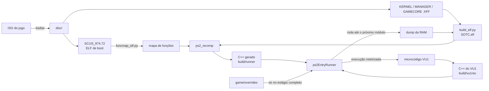
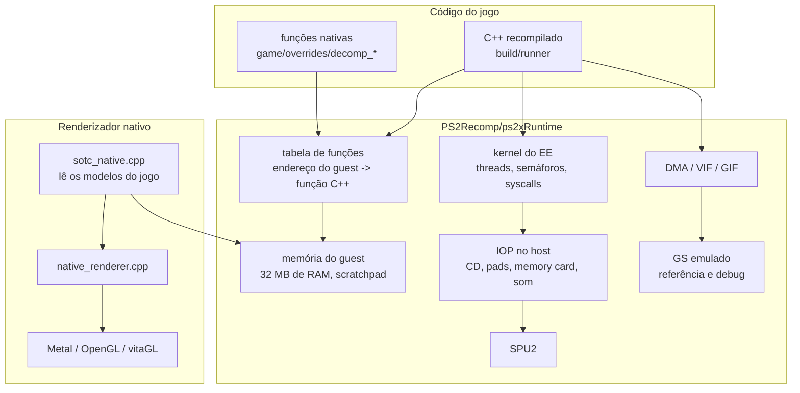

# Arquitetura

Visão geral das peças do port e de como elas se encaixam. Os detalhes de cada
subsistema estão nos documentos linkados (em inglês, como o código).

## Em uma frase

O código MIPS do jogo vira C++ antes da execução (recompilação estática), roda
sobre um runtime que faz o papel do PS2, e as partes que pesam ou que desenham
foram trocadas, aos poucos, por código nativo escrito à mão.

## Pastas

| Pasta | O que é | Quem mexe |
| --- | --- | --- |
| `celosia` | CLI em bash: setup, build, run, vita | à mão |
| `tools/` | pipeline em Python (XFF, ELF, mapas de funções) e ferramentas de análise e profiling | à mão |
| `game/scus.toml` | configuração do recompilador para o ELF de boot | à mão |
| `game/overrides/` | tudo o que é específico do SotC no runtime: funções reescritas, renderizador do jogo, checagens | à mão e gerado (ver abaixo) |
| `PS2Recomp/ps2xRecomp/` | o recompilador: MIPS R5900 para C++ | à mão |
| `PS2Recomp/ps2xAnalyzer/` | análise de ELF: fronteiras de funções, símbolos da SDK | à mão |
| `PS2Recomp/ps2xRuntime/` | o runtime: memória, kernel do EE, DMA, GS, VU, IOP, SPU2 e o renderizador nativo | à mão |
| `PS2Recomp/ps2xTest/` | testes (`ps2x_tests`, suítes MiniTest) | à mão |
| `docs/` | documentação, dados de progresso e a página do GitHub Pages | à mão e gerado |
| `build/` | código recompilado, capturas, build do CMake (fora do git) | gerado |
| `disc/` | disco extraído (fora do git) | `./celosia setup` |

`PS2Recomp/` é um subtree de [ran-j/PS2Recomp](https://github.com/ran-j/PS2Recomp).
As mudanças ali são mantidas genéricas, para poderem voltar ao projeto original.

## Do disco ao executável



O jogo carrega os módulos XFF em tempo de execução e os liga sozinho na
memória. Por isso o `setup` roda o jogo parcialmente recompilado até ele pular
para o próximo módulo, salva a RAM, recorta o módulo já ligado e recompila de
novo com ele. São três voltas (KERNEL, MANAGER, GAMECORE). Os overrides só
entram na última, porque chamam funções de todos os módulos pelo nome.

## Em execução



- **Tabela de funções.** Cada função do guest tem um endereço. A chamada passa
  pela tabela, que aponta para o C++ recompilado ou para uma versão nativa
  registrada com `SOTC_DECOMP_FUNCTION(endereço, nome, função)`
  (`game/overrides/sotc_decomp.h`). Trocar uma função é registrar outra no
  mesmo endereço.
- **Renderizador nativo.** Não traduz pacotes do GS. Lê os dados de modelo do
  próprio jogo na memória (no `modelDisp`) e desenha com Metal no Mac ou
  OpenGL ES no Vita. O GS emulado continua existindo como referência (F9
  alterna as duas imagens). Mapa de cada efeito para a função do jogo:
  [native_renderer_map.md](native_renderer_map.md).
- **Hardware no host.** Timers, interrupções, DMA, módulos do IOP e SPU2 são
  código do host desde o boot.

## O que tem em `game/overrides`

São cerca de 400 arquivos. Os prefixos dizem o que cada um é:

| Prefixo | O que é | Doc |
| --- | --- | --- |
| `sotc_native.cpp` | ponte entre o jogo e o renderizador nativo | [native_renderer_map.md](native_renderer_map.md) |
| `sotc_decomp.*` | registro das funções nativas, difftest, A/B | [decomp.md](decomp.md) |
| `decomp_*.cpp` | funções do jogo reescritas à mão em C++, uma área por arquivo | [decomp.md](decomp.md) |
| `decomp_lift*_NN.cpp` | lotes gerados por `tools/lift_d1.py` | [decomp_d2.md](decomp_d2.md) |
| `typed_a*` | saída do lifter tipado (`tools/typed_lift2.py`), gerada | [decomp_a1.md](decomp_a1.md) |
| `aN_typed_check.cpp` | checagem diferencial das funções tipadas, gerada | [decomp_a11.md](decomp_a11.md) |
| `sN_*` | redesenhos de subsistema por rodada (partículas, colisão, personagens, display) | `docs/*_sN.md` |
| `lean_*` | cópias compactas das funções quentes, para o cache de instruções do Vita | [decomp.md](decomp.md) |
| `*.h` compartilhados | estruturas usadas por mais de um arquivo (uma definição só, por causa do unity build) | |

Nada disso muda o que o jogo faz: cada troca é comparada com o código
recompilado no mesmo estado da máquina (`SOTC_DIFFTEST`, as checagens
`*_CHECK`) antes de virar padrão.

## Build

- CMake com Ninja. O runner (`ps2EntryRunner`) usa **unity build** em lotes de
  32 arquivos. Dois arquivos no mesmo lote compartilham uma unidade de
  tradução: struct definida em dois `.cpp` colide, e um `#include` que só
  existe no vizinho mascara a falta dele. Por isso as estruturas comuns ficam
  em headers, e os arquivos gerados que dependem de `#pragma once`
  parametrizado ficam fora do unity (`PS2Recomp/ps2xRuntime/CMakeLists.txt`).
- O Vita compila os overrides um arquivo por vez, então só o Mac pega esse
  tipo de colisão.

## Testes

```sh
cmake -S PS2Recomp -B build/tests -G Ninja -DPS2X_BUILD_TEST=ON -DPS2X_BUILD_ANALYZER=ON
cmake --build build/tests --target ps2x_tests
build/tests/ps2xTest/ps2x_tests
```

As suítes rodam em ordem alfabética. No Mac algumas suítes antigas do upstream
falham ou derrubam o processo (PS2Memory) antes das últimas; para rodar uma
suíte sozinha, registre só ela num `main` próprio.

## Onde continuar lendo

- [STATUS.md](STATUS.md): o que é nativo hoje, plataforma por plataforma
- [decomp.md](decomp.md): método da descompilação e histórico das rodadas
- [README.md](README.md): índice de todos os documentos
